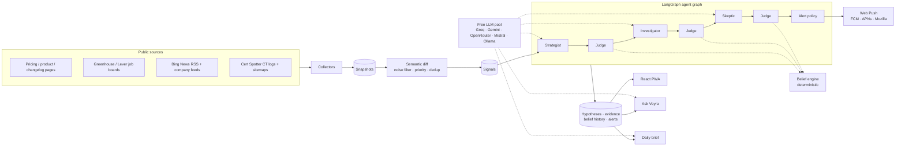

<div align="center">


# Veyra

**Hypothesis-driven competitive intelligence that tests its own conclusions.**


</div>

---

Most competitor-monitoring tools tell you **what changed**. Veyra tells you **what it probably means, how sure to be,
and whether there's a boring explanation**.

Veyra watches the public footprint of the companies you track: pricing pages, changelogs, job boards, news,
certificate logs and sitemaps. Around what it finds, it keeps **persistent hypotheses** about each company's
strategy, such as *"Vercel is moving toward usage-based billing"*. Its AI agents then:

- **investigate** each hypothesis on their own, within strict budgets,
- send a **skeptic** to argue the mundane explanation and actually **test it**,
- **score confidence with deterministic, independence-aware maths** (three articles about one press release count
  once),
- and **measure their own accuracy** in a leakage-safe historical backtest.

Every claim carries evidence links and dates, and every output answers three questions: **what happened, why it
matters, and what to do.**

> Veyra is not the first CI agent: Klue and Crayon exist. Its differentiators are persistent hypotheses, adversarial
> validation, independence-aware confidence, early-signal sources and measured accuracy.

## Table of contents

- [Features](#features)
- [How it works](#how-it-works)
- [Architecture](#architecture)
- [Tech stack](#tech-stack)
- [Quick start (local)](#quick-start-local)
- [Deployment](#deployment)
- [Configuration](#configuration)
- [Free LLM capacity](#free-llm-capacity)
- [Notifications and the installable app](#notifications-and-the-installable-app)
- [Using Veyra](#using-veyra)
- [Evaluation](#evaluation)
- [Security](#security)
- [API reference](#api-reference)
- [Project structure](#project-structure)
- [Testing](#testing)
- [Troubleshooting](#troubleshooting)
- [Limitations](#limitations)

## Features

| | |
|---|---|
| 🧠 **Persistent hypotheses** | Claims about strategy (pricing, product, hiring, market) that gather evidence for and against over weeks, with a full belief timeline. |
| 🔎 **Autonomous investigator** | Plans its own follow-up research with tools: job boards, changelogs, CT logs, sitemaps, page fetches. Bounded to 6 tool calls and 25 fetches per cycle, plus a token budget, and it stops when evidence stops moving confidence. |
| 🥊 **Adversarial skeptic** | Before anything becomes "likely", it proposes at least 2 concrete mundane alternatives (an A/B test, replacement hiring, a single press release counted three times), runs a discriminating test for each, and records a verdict. |
| 📐 **Deterministic belief engine** | Confidence comes from code, not the LLM: priors, source reliability, recency decay, origin-group independence, per-category caps and skeptic adjustments. Labelled *uncalibrated* until measured. |
| 📡 **Early signals** | New subdomains in Certificate Transparency logs and new sitemap paths, labelled *leads, not proof*. |
| 🧪 **Measured accuracy** | A replay of a frozen Wayback dataset, scored against ground truth labelled *before* the first run: precision, recall, lead time, Brier score and calibration with Wilson intervals, with contamination control. |
| 💬 **Ask Veyra** | Chat grounded in the database through read-only tools. Answers cite only sources a tool returned, and belief timelines are drawn from stored history. |
| 📰 **Daily briefs** | What happened / why it matters / what to do, with evidence links and the skeptic's strongest alternative. Saved as Markdown, with optional Slack posting. |
| 🔔 **Push notifications** | Web Push to phones and desktops, even with the app closed, whenever an alert fires. |
| 📲 **Installable PWA** | Works offline for the app shell, installs on Android, iOS and desktop. |
| 🆓 **Free tiers only** | A pool of free LLM providers (Groq, Gemini, OpenRouter, Mistral, local Ollama) with automatic failover. |
| 🔐 **Production ready** | Login, CSRF protection, strict security headers, a hardened Docker image, automatic HTTPS and one-command server setup. |

## How it works

```
 Collect ─▶ Detect ─▶ Strategist ─▶ Judge ─▶ Investigator ─▶ Judge ─▶ Skeptic ─▶ Judge ─▶ Alerts ─▶ Push / Brief
 (Python)   (Python)   (LLM)        (math)   (LLM + tools)   (math)   (LLM+tests) (math)   (rules)
```

1. **Collect.** Polite crawlers fetch each source: they respect robots.txt, wait at least 2 s per host, use a
   descriptive User-Agent and cache responses.
2. **Detect.** Pages are reduced to their main text. A deterministic noise filter drops dates, copyright years,
   reordering and nav changes. Prices are compared line by line. Changes become **typed signals** (`price_change`,
   `plan_change`, `feature_launch`, `hiring_spike`, `new_subdomain`, `removal`, and others) with evidence URLs, dates,
   a priority and an **origin group**, so several reports of one event count once.
3. **Strategist** (LLM). Links new signals to existing hypotheses (stance and relevance, cited by ID) and proposes at
   most 2 new hypotheses, each with falsifiable predictions.
4. **Judge** (no LLM). Recomputes every touched hypothesis deterministically:

   ```
   confidence = sigmoid( logit(prior) + Σ stance × relevance × source_reliability × event_confidence
                                        × recency_decay × independence_weight × K )
   ```
   - **Independence:** the strongest item in an origin group counts 1.0 and the rest 0.2 each.
   - **Decay:** half-lives are pricing 90 d, hiring 45 d, early signals 21 d.
   - **Caps:** each category's contribution is capped.
   - **Skeptic:** each surviving alternative subtracts 0.6 logits.
5. **Investigator** (LLM, bounded). Researches hypotheses in the uncertain band (0.35–0.80). Findings may cite only
   URLs or signals a tool actually returned.
6. **Skeptic** (LLM). Challenges hypotheses at ≥ 0.60. A test that returns no data is always *inconclusive*, never
   "refuted".
7. **Alerts.** Fire only when a hypothesis is raised to *likely* **after** the skeptic has challenged it, or on a
   critical signal (for example a price change above 20%). Alerts are pushed to every subscribed device.

**Guardrails enforced in code, not prompts:**
- Evidence can cite only what a tool returned.
- A re-found URL joins its existing origin group.
- Only news and blog items can be merged as "same event"; page diffs, job data and CT logs never are.
- Nothing becomes *likely* unchallenged.
- Every LLM call and tool call is logged to `agent_runs`.

## Architecture



In production a single origin serves everything: **Caddy** (HTTPS) → **FastAPI** (`/api/*` and the built PWA) →
SQLite on a persistent volume.

## Tech stack

| Layer | Technology |
|---|---|
| Backend | Python 3.11, FastAPI, Uvicorn, SQLAlchemy 2, Pydantic v2 |
| Agents | LangGraph (explicit state graph), Pydantic-validated JSON outputs |
| LLMs | Any OpenAI-compatible API; a free pool of Groq, Google Gemini, OpenRouter, Mistral and Ollama |
| Collection | httpx, trafilatura, selectolax, feedparser; Wayback CDX for history |
| Scheduling | APScheduler (in-process) |
| Frontend | React 18, TypeScript, Vite 6, Tailwind CSS 4, Recharts, marked + DOMPurify |
| PWA | vite-plugin-pwa (Workbox), Web Push (VAPID via pywebpush) |
| Storage | SQLite (Postgres-compatible schema) |
| Deployment | Docker (multi-stage, non-root, read-only), Docker Compose, Caddy (automatic HTTPS) |
| Tests | pytest (96 tests: no network, no LLM) |

## Quick start (local)

**You need:** Python 3.11+ (on Windows, the python.org installer, run as `py -3.11`), Node.js 20+, and at least one
free LLM key (see [Free LLM capacity](#free-llm-capacity)).

```bash
git clone https://github.com/aryanpol73/veyra.git
```
```bash
cd veyra
```
```bash
py -3.11 run.py
```

`run.py` does the rest on first run:
- creates `backend/.venv` and installs the dependencies
- copies `.env.example` to `.env`
- runs `npm install`
- starts the API on `:8000` and the dashboard at **http://localhost:5173**

**Ctrl+C** stops both, including child processes. Add your keys to `.env` and restart.

The app starts **empty**: the Overview walks you through adding your first competitor. In development, login is off
unless you set `VEYRA_ADMIN_PASSWORD`.

> **Windows:** keep the repo at a short path such as `C:\Users\you\veyra`. A LangGraph dependency ships a DLL that
> fails to load past Windows' 260-character path limit. `run.py` warns when the path is long. Use PowerShell or CMD;
> Git Bash's `python` is MSYS2's, which breaks the virtual environment.

## Deployment

### Option A: Docker on any machine

```bash
docker compose up -d --build
```

This needs, in `.env`:
- at least one LLM key
- `VEYRA_ADMIN_PASSWORD` (10+ characters)
- `VEYRA_SECRET_KEY`, generated with `python -c "import secrets; print(secrets.token_hex(32))"`

Then open `http://localhost:8000` (change it with `VEYRA_PORT`). The container:
- **is hardened:** non-root, read-only filesystem, `no-new-privileges`, a health check, automatic restart and rotated
  logs;
- **keeps data** in the `veyra-data` volume;
- **runs scheduled cycles** every 6 hours.

### Option B: public, free, always on (recommended)

Follow **[docs/DEPLOY.md](docs/DEPLOY.md)**. In short:

1. Create an **Oracle Cloud Always Free** Ubuntu server (permanently free: always on, persistent disk).
2. Get a free domain at **DuckDNS** pointing at it.
3. On the server, run:
   ```bash
   curl -fsSL https://raw.githubusercontent.com/aryanpol73/veyra/main/deploy/setup-ubuntu.sh -o setup.sh && bash setup.sh
   ```

The script installs Docker, opens the firewall, asks for your domain, password and keys, and starts Veyra behind
**Caddy**, which gets a Let's Encrypt certificate automatically. You get `https://your-name.duckdns.org`, installable
on your phone, with push notifications.

Free hosts that sleep or have no persistent disk, such as Render's free tier, can't run Veyra: it must stay on to
check competitors and send alerts.

## Configuration

All settings come from environment variables or `.env`. See [`.env.example`](.env.example) for a template.

| Variable | Default | Purpose |
|---|---|---|
| `GROQ_API_KEY` / `LLM_API_KEY` | – | Groq key (`LLM_API_KEY` is used when `LLM_PROVIDER=groq`) |
| `GEMINI_API_KEY` | – | Google AI Studio key |
| `OPENROUTER_API_KEY` | – | OpenRouter key (uses its current `:free` models) |
| `MISTRAL_API_KEY` | – | Mistral free "Experiment" plan |
| `OLLAMA_LOCAL` / `OLLAMA_API_KEY` | `false` / – | Local Ollama, or Ollama Cloud (needs credits) |
| `LLM_STRONG_CHAIN`, `LLM_FAST_CHAIN` | built-in | Custom failover order, e.g. `groq:openai/gpt-oss-120b,mistral:mistral-medium-latest` |
| `VEYRA_ENV` | `development` | `production` requires a strong password and secret, and disables API docs |
| `VEYRA_ADMIN_PASSWORD` | – | Single admin login (10+ characters in production) |
| `VEYRA_SECRET_KEY` | – | Signs session cookies (32+ random characters) |
| `VEYRA_COOKIE_SECURE` | on in production | Secure cookies; set `false` only for plain-HTTP LAN use |
| `VEYRA_PORT` | `8000` | Host port for Docker without Caddy |
| `VEYRA_DOMAIN` | – | Public domain for the Caddy deployment |
| `VEYRA_DATA_DIR` | `data/` (`/data` in Docker) | Database, cache, briefs, eval runs, push keys |
| `SCHEDULER_ENABLED` / `CYCLE_INTERVAL_MIN` | off locally, on in Docker / `360` in Docker (`720` otherwise) | Automatic collection and agent cycles |
| `USER_AGENT_EMAIL` | `veyra-bot@example.com` | Contact address in the crawler's User-Agent |
| `SLACK_WEBHOOK_URL` | – | Post daily briefs to Slack |
| `VAPID_PUBLIC_KEY` / `VAPID_PRIVATE_KEY` | auto-generated | Pin your own Web Push keys |
| `INVESTIGATOR_ROLE` | `fast` | Model tier the investigator uses (`strong` for quality) |
| `LOG_LEVEL` | `INFO` | Server log level |

Agent budgets (tool calls, fetches, tokens, the uncertain band and thresholds) live in
[`backend/app/config.py`](backend/app/config.py).

## Free LLM capacity

No single free tier is big enough, so Veyra keeps a **pool** ([`llm_pool.py`](backend/app/llm_pool.py)):
- **Order:** each role ("strong" for strategy/skeptic/chat, "fast" for classification/investigation) has an ordered
  list of free endpoints.
- **Daily caps:** when one hits its daily cap, it rests until the reset and the next takes over.
- **Bad keys or models:** bad keys, retired models and "needs credits" (402) responses park an endpoint for 6 h.
- **Throttling:** each endpoint has its own tokens-per-minute throttle.
- **JSON mode:** turned off automatically where a provider doesn't support it.
- **OpenRouter:** its free models are looked up live every 6 h, because that list changes often.

| Key | Where (free) | Notes |
|---|---|---|
| `GROQ_API_KEY` | [console.groq.com/keys](https://console.groq.com/keys) | 3 models with **separate** daily caps (~200k tokens/day each) |
| `GEMINI_API_KEY` | [aistudio.google.com/apikey](https://aistudio.google.com/apikey) | Gemini Flash / Flash-Lite free tier |
| `OPENROUTER_API_KEY` | [openrouter.ai/keys](https://openrouter.ai/keys) | `:free` models, 50 requests/day |
| `MISTRAL_API_KEY` | [console.mistral.ai](https://console.mistral.ai) | Large free allowance; phone verification; free-plan data may be used for training |
| `OLLAMA_LOCAL=true` | [ollama.com](https://ollama.com/download) | Unlimited and offline on your own hardware |

Check every key with one tiny request each:

```bash
docker exec veyra python -m app.llm_check
```

(Locally: `cd backend` then `.venv\Scripts\python -m app.llm_check`.) Free-tier limits change often; check each
provider's dashboard.

## Notifications and the installable app

**Install it:**
- **Android:** Chrome → menu → *Install app*.
- **iPhone/iPad:** Safari → *Share → Add to Home Screen*.
- **Desktop:** the install icon in Chrome or Edge's address bar.

The app shell is precached and works offline. API data is never cached, because it's private and must be fresh.

**Push notifications** use the browser makers' push services (Google FCM, Apple, Mozilla):
- **Delivery:** alerts reach each subscribed device **wherever it is, with the app closed**. If the device is offline,
  they arrive when it reconnects (held up to 24 h).
- **Critical alerts** stay on screen until dismissed (where the platform supports it).
- **Enabling:** Overview → **Notifications → Enable**, then **Send test notification**, once per device.

What notifications need:
- The server running, with scheduled cycles on (the default in Docker).
- HTTPS: the public deployment, or `http://localhost` on the same machine.
- On **iOS (16.4+)**: enabled from the **home-screen app**. iOS doesn't offer web push to a normal Safari tab.

## Using Veyra

| Page | What it does |
|---|---|
| **Overview** | KPIs, top hypotheses, high-priority signals, alerts with *Useful / Noise* feedback, notifications, system status and the LLM test |
| **Hypotheses** | Status and confidence ring, evidence for and against with weights, belief-over-time chart (and a table view), skeptic alternatives with their tests and verdicts, investigation log, predictions |
| **Intelligence Feed** | Every signal with evidence and provenance (Early Signal, Removal, Replay, Synthetic); **Run cycle now** |
| **Competitors** | Add **any company in any field**: type a domain and press **Discover**, and Veyra finds its pricing page, changelog, feeds and job board for you to review |
| **Ask Veyra** | Questions like *"How has X's pricing evolved?"*, answered from belief history with cited sources |
| **Evaluation** | Backtest metrics, calibration chart with Wilson intervals, contamination-mode switch, run button |
| **Reports** | Daily brief archive; generate a new brief on demand |

## Evaluation

Veyra measures its own accuracy with a **leakage-safe replay**:

```bash
cd backend
.venv/Scripts/python -m app.eval.run_eval --mode masked --synthetic   # Docker: docker exec veyra python -m app.eval.run_eval ...
```

- **Data:** `data/replay/` has 107 monthly Wayback captures (Jan–Nov 2026) of 3 companies' pricing, homepage and
  changelog pages and blog feeds.
- **Replay:** the same pipeline steps `as_of` month by month in its own database. Tools filter by `as_of`, any live
  fetch raises an error, and tests assert that nothing after `as_of` leaks in.
- **Ground truth:** [`ground_truth.yaml`](backend/app/eval/ground_truth.yaml) has 15 real events, each dated by an
  official announcement. It was labelled and committed **before** the first replay.
- **Metrics:** precision, recall, lead time, false-positive rate, false alarms per competitor-month, Brier score, and
  3-bin calibration with Wilson 95% intervals.
- **Contamination control:** `masked` hides company and product names from every prompt; `none` is flagged *possibly
  contaminated*.
- **Synthetic test:** checks that independent evidence beats one press release counted three times, by at least 0.05.

**Pilot results** (masked, 2026-11-19):

| Metric | Value |
|---|---|
| Precision / recall | 0.13 / 0.13 (n = 15) |
| True positives | 2, both early: **+90 and +60 days** before announcement |
| Calibration, high bin | 1/8 hits, Wilson 95% [0.02, 0.47] |

**What these numbers mean:**
- **The early catches are real:** Vercel's enterprise commitment contracts and its AI Gateway build-out.
- **Most specific launches were missed,** because the hypotheses tend to be broad themes.
- **Scores are overconfident**, so they stay labelled *uncalibrated*.
- **This run predates two fixes** found by the synthetic test (same-event merging, and skeptic verdicts on empty
  tests), so a re-run is pending. One backtest uses about 230k tokens, so plan around free-tier daily caps.

## Security

**Authentication**
- **Login:** a single admin password, compared in constant time.
- **Sessions:** HMAC-signed, **HttpOnly, SameSite=Strict** cookies (Secure in production) that last 7 days.
- **Brute force:** 5 failed attempts per IP lock login for 15 minutes.

**Requests**
- **CSRF:** every state-changing request must carry the `X-Veyra` header, which browsers never add cross-site.

**Fails closed**
- With `VEYRA_ENV=production`, the server **refuses to start** without a strong password and secret.

**Responses**
- **Headers:** strict Content-Security-Policy (no inline scripts, no third-party origins), `X-Frame-Options: DENY`,
  `nosniff`, a referrer policy and HSTS.
- **Errors and caching:** API docs are off in production, error messages never include stack traces, and private
  responses are `no-store`.

**Runtime**
- **Container:** non-root user, read-only root filesystem, `no-new-privileges`.
- **Network:** behind Caddy, Veyra has no public port.

**Secrets and data**
- **Secrets:** `.env` is git-ignored, and the setup script writes it as `chmod 600`. Web Push keys live in the data
  volume (`0600`).
- **Crawling:** respects robots.txt and doesn't scrape LinkedIn, review sites or social platforms.

## API reference

All routes are under `/api` in production (FastAPI's interactive docs are at `/docs` in development). Everything except
`/healthz` and `/auth/*` requires login.

| Area | Endpoints |
|---|---|
| Auth | `POST /auth/login` · `POST /auth/logout` · `GET /auth/status` |
| Health | `GET /healthz` (public) · `GET /health` (`?llm_check=true` pings the pool) |
| Competitors | `GET/POST /competitors` · `GET/PUT/DELETE /competitors/{id}` · `GET /sources` · `GET /discover?domain=` |
| Cycles | `POST /cycle/run` (`{"collect": true, "agents": true}`) · `GET /cycle/status` |
| Signals | `GET /signals?competitor&category&priority&type&since` · `GET /signals/stats` |
| Hypotheses | `GET /hypotheses` · `GET /hypotheses/{id}` (evidence, history, challenges, investigations, predictions) |
| Alerts | `GET /alerts` · `POST /alerts/{id}/feedback` |
| Chat & briefs | `POST /chat` · `POST /reports/daily` · `GET /reports` · `GET /reports/daily` · `GET /reports/{date}` |
| Overview | `GET /overview` · `GET /agent-runs` |
| Evaluation | `POST /eval/run` · `GET /eval/status` · `GET /eval/runs` · `GET /eval/runs/latest` · `GET /eval/runs/{id}` |
| Push | `GET /push/key` · `GET /push/status` · `POST /push/subscribe` · `POST /push/unsubscribe` · `POST /push/test` |

## Project structure

```
veyra/
├── backend/
│   ├── app/
│   │   ├── main.py            API routes          server.py   production server (API under /api + PWA)
│   │   ├── auth.py            login, sessions     push.py     Web Push (VAPID, subscriptions, delivery)
│   │   ├── llm.py · llm_pool.py · llm_check.py      free-tier LLM pool with failover
│   │   ├── cycle.py           collection + agent cycle runner, scheduler hook
│   │   ├── collectors/        pages, jobs, news, early signals, wayback, discovery, polite fetcher
│   │   ├── detect/            semantic diff, detectors, priority/dedup/origin groups, snapshots
│   │   ├── agents/            LangGraph graph, strategist, investigator, skeptic, judge, chat, tools, prompts
│   │   ├── belief/engine.py   deterministic confidence scoring
│   │   ├── eval/              dataset, replay, metrics, run_eval, ground_truth.yaml, import_replay
│   │   ├── reports/brief.py   daily brief
│   │   └── db/                models, session, sources
│   └── tests/                 96 tests
├── frontend/                  React + Vite + Tailwind PWA (pages, components, service-worker push handlers)
├── data/replay/               frozen Wayback dataset (committed); runtime data is git-ignored
├── deploy/                    Caddyfile, setup-ubuntu.sh
├── docs/                      DEPLOY.md (public deployment), DEMO.md (demo script)
├── Dockerfile · docker-compose.yml · docker-compose.deploy.yml
└── run.py                     one-command local start
```

## Testing

```bash
cd backend
.venv/Scripts/python -m pytest -q
```

96 tests, with no network and no LLM calls. They cover:
- the belief engine
- change detection (noise filter, line-paired prices, boilerplate stripping)
- agent guardrails (citations, merges, skeptic rules)
- replay leakage and metrics
- the LLM pool's failover and retry paths
- chat grounding, briefs and discovery
- auth (sessions, tampering, CSRF, throttling)
- the production server (headers, static files, SPA fallback, path traversal)
- Web Push

Frontend:

```bash
cd frontend
npx tsc -b && npm run build
```

## Troubleshooting

| Problem | Fix |
|---|---|
| `port is already allocated` | Another server is on that port. Stop it, or set `VEYRA_PORT=8080` in `.env`. |
| Container exits with "refusing to start" | Set `VEYRA_ADMIN_PASSWORD` (10+ characters) and `VEYRA_SECRET_KEY` (32+) in `.env`. |
| `No module named app.llm_check` | The container predates the feature: rebuild with `docker compose up -d --build`. |
| Agents skipped: "no LLM configured" | Add at least one key, then run `app.llm_check`. |
| "rate limit is reached" in chat | Free-tier caps; the pool fails over. Add more free keys for more capacity. |
| `filename or extension is too long` (Windows) | Move the repo to a shorter path. |
| No notification on iPhone | Enable it from the **home-screen app** (iOS 16.4+), not a Safari tab. |
| Docker engine not running | Open Docker Desktop once after each reboot. |

## Limitations

- **The evaluation is a pilot:** 15 events, one labeller, keyword matching, monthly replay steps (lead times accurate
  to about ±30 days), and scores that are not yet calibrated.
- **Early signals are leads, not proof:** on the first run, a "new subdomain" means every live certificate for it is
  under 21 days old.
- **Hiring-spike z-scores** use the current board, so filled roles that disappeared are under-counted.
- **Sites that block bots or need JavaScript** yield little text, so Discover may find nothing on them.
- **Free-tier LLM limits** constrain how much runs per day, and providers change their free models often.
- **Single admin, single process:** there are no multi-user accounts, and the app scales up, not out (one process
  holds the cycle status and the single SQLite writer).
- **Alert feedback** (Useful / Noise) is stored but not learned from yet.

---

<div align="center">
Built by <a href="https://github.com/aryanpol73">@aryanpol73</a> as a Generative AI &amp; Agentic AI project.
</div>
