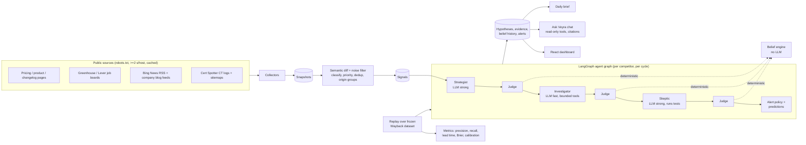

# Veyra: Hypothesis-Driven Competitive Intelligence Agent

Veyra is an autonomous, hypothesis-driven competitive-intelligence system. It investigates competing explanations and
measures its own prediction accuracy.

Most monitoring tools report "what changed". Veyra keeps **persistent, evidence-backed hypotheses** about each
competitor's strategy, such as "Vercel is moving toward usage-based billing". Around each one it:
- plans its own **follow-up investigations**,
- has a **skeptic** argue the mundane explanation and actually test it,
- updates an **independence-aware confidence score**: three articles about one press release count once,
- measures its own accuracy with a **leakage-safe historical backtest**.

Veyra is not the first CI agent: Klue and Crayon exist. Its differentiators are persistent hypotheses, adversarial
validation, independence-aware confidence, early-signal sources and measurable backtesting.

Every output answers three questions: **what happened, why it matters, and what to do.** Every claim carries evidence
links and dates.

> College project for "Generative AI & Agentic AI". Demo walkthrough: [`docs/DEMO.md`](docs/DEMO.md).

## Architecture



Only the strategist, investigator, skeptic, chat and reporter call an LLM. Fetching, diffing, dedup, scoring, alert rules
and scheduling are plain Python.

## Quick start

You need **Python 3.11+** (the python.org installer; on Windows run `py -3.11`), **Node.js 20+** and, for the agents and
chat, a free **Groq API key** from [console.groq.com/keys](https://console.groq.com/keys).

```bash
py -3.11 run.py
```

The first run creates `backend/.venv`, installs dependencies, copies `.env.example` to `.env`, seeds 3 competitors
(Vercel, Figma, Airtable) and runs `npm install`. It then serves the dashboard at http://localhost:5173 and the API docs at
http://127.0.0.1:8000/docs. **Ctrl+C** stops both servers, including their child processes.

Put your key in `.env` (never commit it; `.env` is git-ignored):

```ini
LLM_PROVIDER=groq
LLM_API_KEY=gsk_...
```

| Provider | `LLM_PROVIDER` | Key | Default strong / fast models |
|---|---|---|---|
| Groq (free tier) | `groq` | console.groq.com/keys | `openai/gpt-oss-120b` / `openai/gpt-oss-20b` |
| Ollama Cloud (paid credits) | `ollama_cloud` | ollama.com/settings/keys | `gpt-oss:120b` / `gpt-oss:20b` |
| Local Ollama | `ollama_local` | none | `llama3.1:8b` |

Any OpenAI-compatible endpoint works through `LLM_BASE_URL`, `LLM_STRONG` and `LLM_FAST`. Use **Test LLM** on the
Overview page to check the connection. Without a key, the dashboard and collectors still work: signals are rule-classified
and the agents are skipped.

> **Windows:** keep the repo at a short path such as `C:\Users\you\veyra`. LangGraph's `xxhash` dependency ships a DLL
> that fails to load past the 260-character path limit. `run.py` warns when the path is long.

## Using it

| Page | What it shows |
|---|---|
| **Overview** | KPIs, top hypotheses, high-priority signals, and alerts with **Useful / Noise** buttons |
| **Hypotheses** (flagship) | Status and confidence band, evidence for and against with links and weights, belief-over-time chart, skeptic alternatives with the test each ran and its verdict, investigation log, predictions |
| **Intelligence Feed** | Typed signals filtered by competitor, category and priority; **Run cycle now**; badges for Early Signal, Removal, Synthetic and Replay |
| **Competitors** | Track **any company in any field**: type its domain and press **Discover**. Veyra finds the pricing page, changelog, RSS feeds and Greenhouse/Lever job board for you to review. The 3 seeded companies are only demo data; delete them freely. |
| **Ask Veyra** | Chat grounded in the database, with cited sources and belief timelines |
| **Evaluation** | Backtest metrics, calibration with Wilson intervals, the contamination-mode switch and a caveat banner |
| **Reports** | Archive of daily briefs: generate one and read it |

Main API endpoints:
- **Competitors and data:** `GET/POST/PUT/DELETE /competitors`, `GET /signals`, `GET /hypotheses`, `GET /hypotheses/{id}`, `GET /alerts`
- **Cycles:** `POST /cycle/run` (body `{"collect": true, "agents": true}`), `GET /cycle/status`
- **Alerts:** `POST /alerts/{id}/feedback`
- **Chat and briefs:** `POST /chat`, `POST /reports/daily`, `GET /reports`
- **Evaluation:** `POST /eval/run`, `GET /eval/runs/latest`

## How the agent core works

Each cycle, per competitor: `strategist -> judge -> investigator -> judge -> skeptic -> judge -> alert policy`.

| Step | LLM? | What it does |
|---|---|---|
| Strategist | strong | Links new signals to hypotheses (stance and relevance, cited by ID). Proposes at most 2 new hypotheses with falsifiable predictions. Flags news items that report the same event. |
| Investigator | fast | Bounded tool loop on hypotheses in the uncertain band (0.35–0.80): at most 6 tool calls, 25 fetches per cycle, plus a token budget. Stops when new evidence stops moving confidence. |
| Skeptic | strong | At confidence >= 0.60, proposes >= 2 concrete mundane alternatives, each with a tool test that is **actually run**, then gives a strict verdict per alternative. |
| Judge | no | Deterministic belief engine (`backend/app/belief/engine.py`), status, alert policy and prediction registry |

**Confidence** = sigmoid(logit(prior) + Σ stance × relevance × source reliability × event confidence × recency decay ×
independence × K).
- **Independence:** the strongest item in an origin group counts 1.0; the rest count 0.2 each.
- **Recency:** each category has its own half-life (pricing 90 days, hiring 45, early signals 21).
- **Caps and skeptic:** each category's total is capped, and surviving skeptic alternatives subtract.

Three confidences are kept apart:
- *event confidence*: did it happen?
- *interpretation confidence*: is our reading right? This is the score shown.
- *prediction confidence*: will the forecast come true?

**Guardrails enforced in code, not prompts:**
- Evidence can cite only signal IDs or URLs that a tool actually returned.
- A re-found URL joins the existing signal's origin group, so it isn't counted twice.
- Only news and blog items can be merged as "same event"; page diffs, job data and CT logs are never merged.
- Nothing becomes "likely" before the skeptic has challenged it, and alerts never fire on unchallenged claims.
- A skeptic test that returns no data is always "inconclusive". The model had "refuted" alternatives on empty results.
- Interactive calls never wait minutes on a rate limit.

Every LLM call and tool call is logged to `agent_runs`.

## Evaluation (pilot backtest)

```bash
cd backend
.venv/Scripts/python -m app.eval.dataset                       # (re)build the frozen Wayback dataset
.venv/Scripts/python -m app.eval.run_eval --mode masked --synthetic
.venv/Scripts/python -m app.eval.run_eval --mode none          # flagged "possibly contaminated"
.venv/Scripts/python -m app.eval.run_eval --score-only ../data/eval/<replay>.db   # re-score without the LLM
.venv/Scripts/python -m app.eval.import_replay ../data/eval/<replay>.db           # browse it on the Hypotheses page
```

- **Data:** `data/replay/` holds 107 monthly Wayback captures (Jan–Nov 2026) of each competitor's pricing, homepage and
  changelog pages plus blog feeds. Jobs, CT logs and news search have no reliable public history, so they're off in replay.
- **Replay:** the same detectors and agent graph run month by month (`as_of`) from 2026-05-01 to 2026-11-18, in their own
  SQLite file. Tools filter by `as_of`, any live fetch raises an error, and `tests/test_replay.py` asserts that no data
  after `as_of` leaks in.
- **Ground truth:** `backend/app/eval/ground_truth.yaml` has 15 real events, each dated by an official announcement. It
  was labelled and committed (`2be03ce`) **before the first replay**; matching is keyword-on-statement, as defined in the file.
- **Metrics:** precision, recall, lead time, false-positive rate, false alarms per competitor-month, Brier scores, and
  3-bin calibration with Wilson 95% intervals. Peak-confidence calibration is a secondary view added after the first run.
- **Contamination control:**
  - `masked` replaces company and product names with tokens in every prompt.
  - `none` is unmasked.
  - `post_cutoff` keeps only events after the model's training cutoff. gpt-oss's cutoff is mid-2024, so on this 2026
    dataset it keeps every event.
  - The **synthetic injection test** checks the machinery: independent evidence must beat one press release counted
    three times by at least 0.05. It measures nothing about real-world accuracy.

### Pilot results (masked mode, run #3, 2026-11-19)

| Metric | Value | n |
|---|---|---|
| Precision | 0.13 | 15 detected hypotheses |
| Recall | 0.13 | 15 events |
| Lead time (true positives) | +90 d, +60 d | 2 |
| False alarms per competitor-month | 0.66 | |
| Brier (hypotheses, final confidence) | 0.405 | 18 |
| Brier (resolved predictions) | 0.335 | 18 |
| Calibration, high bin (>= 0.7) | 1/8 hits, Wilson 95% [0.02, 0.47] | 8 |

**What the results mean:**
- **Two early catches:** Veyra caught Vercel's enterprise commitment contracts and its AI Gateway build-out months
  before they were announced.
- **Most specific launches missed** (Vercel CI, Figma Motion, Specs). Its hypotheses are broad themes, such as
  "building a developer platform", that the pre-declared keywords don't match.
- **Overconfident scores:** most high-confidence hypotheses don't correspond to a specific event, so the scores are
  **uncalibrated**.
- **Degraded run:** one strategist call hit Groq's daily cap on the final step.
- **Re-run pending:** the synthetic test then exposed a flaw, the strategist merging independent page diffs. It's fixed
  and regression-tested, so **both modes need a re-run** for post-fix numbers.

## Data sources

| Source | Endpoint | Notes |
|---|---|---|
| Pages | Competitor pricing, homepage and changelog | trafilatura main text. The first run diffs against a Wayback capture >= 30 days old |
| Jobs | Greenhouse and Lever public JSON | Broad terms like "AI" count only in job titles, because company blurbs mention AI everywhere |
| News | Bing News RSS + company blog/changelog feeds | Google News RSS is robots-disallowed, so it isn't used |
| Early signals | Cert Spotter CT API, `sitemap.xml` | Leads, not proof. crt.sh is robots-disallowed; Cert Spotter allows ~10 anonymous requests/hour |

LinkedIn, review sites and social platforms are deliberately not scraped.

## Tests

```bash
cd backend && .venv/Scripts/python -m pytest -q      # 66 tests, no network, no LLM
```

They cover:
- the belief engine (independence, decay, caps, skeptic adjustments, status gates)
- detection (noise filter, line-paired prices, boilerplate stripping)
- agent guardrails (citations, merges, lenient formats)
- replay leakage, metrics, the LLM client's retry and fallback paths, chat grounding, and briefs

## Project layout

```
backend/app/
  collectors/   pages, jobs, news, early_signals, wayback, polite cached fetcher
  detect/       semantic_diff, detectors, normalize (priority, dedup, origin groups), snapshot
  agents/       graph (LangGraph), strategist, investigator, skeptic, judge, chat, tools, schemas, prompts
  belief/       engine.py: the deterministic scoring
  eval/         dataset, replay, metrics, run_eval, ground_truth.yaml
  reports/      brief.py
frontend/src/   pages (Overview, Hypotheses, Feed, Competitors, Ask, Evaluation, Reports), components
data/replay/    frozen Wayback dataset (committed); veyra.db, cache/, eval/, reports/ are git-ignored
```

## Limitations

**Scores**
- Confidence scores are an **uncalibrated heuristic**, and the pilot calibration shows they are overconfident.

**The evaluation**
- It's a pilot: 15 events, one labeller and keyword matching. Monthly replay steps make lead times accurate to about
  ±30 days.
- Masking hides names, not facts, so a model may still recognise a company from product details. If the model
  invents a variant of a masked token (e.g. `companya.com` for `companya.example`), it isn't unmasked.
- Replay classifies signals with rules, while the live system uses the LLM; replay also has no jobs, CT or news history.
- Replay run #3 predates the skeptic "no data means inconclusive" rule, so some of its stored verdicts are "refuted" on
  empty tests.

**Signals**
- CT-log and sitemap signals are **leads, not proof**. On the first run, a "new subdomain" means every live certificate
  for it is under 21 days old, so a renewal can occasionally look new.
- Hiring-spike z-scores use posting dates on the *current* board. Filled roles disappear, so older weeks are
  under-counted.

**The free LLM tier**
- Groq's free tier allows 8k tokens/minute and 200k/day per model. One masked backtest uses ~230k, so a masked +
  unmasked pair takes two days.
- Groq's model lineup changes. If a model 404s, set `LLM_STRONG` / `LLM_FAST` in `.env`.

**Not built yet**
- Alert feedback is stored but not learned from.
- There's no auth or multi-tenancy, and no scheduler unless `SCHEDULER_ENABLED=true`.
